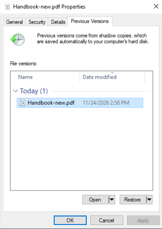

# Enabling Windows Previous Versions (Shadow Copy) on NAS CIFS Shares

Windows users can recover earlier copies of files and folders on a NAS CIFS share themselves, directly from the volume's snapshots. They right-click the item on the mapped drive and open the **Previous Versions** tab, so an accidental change or deletion can be undone without an administrator restoring the whole volume.

## Overview


**Key Points**

- ***Previous Versions*** on a CIFS share is built from **NAS volume snapshots**, scheduled or manual. System snapshots aren't included.
- To turn it on, enable **Automatically Mount Snapshots** on the **volume** and **Enable shadow copy** on the **CIFS share**.
- A **Snapshot Profile** is recommended for regular snapshots and automatic retention. Retained snapshots determine how far back users can go.
- A file lists previous versions only where it changed between snapshots.


## Prerequisites

- A NAS service with a **local** volume. Volume snapshots aren't supported on remote volumes, so *Previous Versions* isn't available on shares of a remote volume. See [Local Volumes](https://app.gitbook.com/s/pODKGSQETqL1gSqyxIq3/nas/nas-local-volumes).
- A CIFS share on that volume, and Windows clients that can already map and use it. See [Shares](https://app.gitbook.com/s/pODKGSQETqL1gSqyxIq3/nas/nas-shares).
- Recommended: a [Snapshot Profile](https://app.gitbook.com/s/sppYQkyIET58BuAo0kqm/backup-and-dr/snapshot-profiles) whose schedule and retention match how far back you want users to be able to go. You can use an existing profile or create one for this volume. Without a profile, users can only restore from manual snapshots.

## Step 1: Enable Automatically Mount Snapshots on the Volume

1. Navigate to **NAS** > **Volumes** and double-click the volume to open its dashboard.
2. Click **Edit** on the left menu.
3. Select **Automatically Mount Snapshots**.
4. Click **Submit**.

The volume's snapshots are now mounted in a `.snapshots` directory at the root of the volume. This is what the CIFS share reads from to present previous versions.


The `.snapshots` directory is excluded from volume syncs by default, so enabling this option doesn't cause snapshot contents to be copied by your syncs. See [Volume Syncs](https://app.gitbook.com/s/pODKGSQETqL1gSqyxIq3/nas/volume-syncs).


## Step 2: Enable Shadow Copy on the CIFS Share

1. From the top menu, select **NAS** > **CIFS Shares**.
2. Double-click the share to open it, then click **Edit** on the left menu.
3. Select **Enable shadow copy**. This option enables mounted snapshots to be used for the Windows Previous Versions feature.
4. Click **Submit**.

To offer Previous Versions on more than one share of the same volume, select **Enable shadow copy** on each of those shares.

## Step 3: Verify from a Windows Client

Users need at least one volume snapshot to see previous versions. To test:

1. On a Windows client, open the mapped share in File Explorer and create and save a test file.
2. Take a manual snapshot of the volume (volume dashboard > **Take Snapshot**). The snapshot captures the test file as it is now.
3. Edit and save the test file again. A file lists a previous version only if it changed after the snapshot was taken.
4. Right-click the file and select **Properties**, then select the **Previous Versions** tab. (On Windows 11, you can also right-click and select **Show more options > Restore previous versions**.)
5. Confirm the list shows an entry with a date that matches the snapshot.

## Step 4: Assign a Snapshot Profile to the Volume (Recommended)

A snapshot profile isn't required for Previous Versions; manual snapshots work too. In most cases, though, you'll want a profile so snapshots are taken regularly and retention is handled automatically. Skip this step if the volume already has a profile, or if you plan to use only manual snapshots.

1. Navigate to **NAS > Volumes** and double-click the volume to open its dashboard.
2. Click **Edit** on the left menu.
3. In the **Snapshot Profile** field, select the profile from the dropdown list.
4. Click **Submit**.


**Choosing a profile for Previous Versions**

Each retained volume snapshot is a possible restore point. Users see it for a file only if the file changed between snapshots. For example, a profile that takes a snapshot every hour and keeps 12, plus a daily snapshot kept for 7 days, gives users hourly restore points for the previous 12 hours and daily restore points for the past week.

Keep the number of retained snapshots reasonable. Every snapshot consumes more vSAN space as the volume's data changes, and a very long list of versions is harder for users to work with. See [NAS Volume Snapshots and Restores](https://app.gitbook.com/s/pODKGSQETqL1gSqyxIq3/nas/volume-snapshots-restores) for more on volume snapshot scheduling and space usage.


## Restoring a File or Folder (End-User Steps)

Share these steps with Windows users once Previous Versions is enabled.


These steps are based on Windows 10 and 11. Menu names and dialog layouts can vary slightly between Windows versions. If your screens look different, see Microsoft's instructions for [restoring previous versions of files and folders](https://support.microsoft.com/help/17119) (see the **Restore files with File History** section).


1. In File Explorer, browse to the file or folder on the mapped drive. To recover a deleted file, browse to the folder that contained it.
2. Right-click the item and select **Properties > Previous Versions**.
3. Select the version you want by its date and time, then choose one of the following:
   - **Open** – View the earlier version (read-only) to confirm it's the one you need.
   - **Restore to** – Save the earlier version to a different location. Select the arrow next to **Restore**, then **Restore to**. The current file isn't changed. This is the safest option.
   - **Restore** – Replace the current file or folder with the earlier version. Changes made since that version was taken are lost.


**Restore overwrites the current copy**

Using **Restore** replaces the current file or folder contents on the share. If you aren't sure which version you need, use **Restore to** to save the earlier version elsewhere first, then compare.


## How Previous Versions Behaves

- **Only changed files list versions.** Windows doesn't list every snapshot for every file. It lists a previous version only when the file's contents differ from the copy in the next newer snapshot (or from the current file), so identical copies are skipped. A file that hasn't changed since the oldest retained snapshot shows no previous versions at all, even though snapshots exist. Folders behave the same way, based on changes to their contents.
- **Restore points follow the volume's snapshots.** Scheduled snapshots expire according to the snapshot profile's retention, and manual snapshots expire at the **Expires** date set when they were taken. When a snapshot expires, its version disappears from the Previous Versions list. Users can't go back further than the oldest retained volume snapshot.
- **Snapshots are read-only.** Users can open and restore from a previous version, but they can't change or delete snapshots from Windows. Administrators manage snapshots from the volume dashboard.
- **Permissions still apply.** A user can only open or restore items through the share that they have access to. Previous versions also keep the permissions the file had when the snapshot was taken.
- **Whole-volume recovery is still available.** For large-scale recovery, such as after ransomware, restore the whole volume from a snapshot with **Restore over Source** or **Restore To New** instead. See [NAS Volume Snapshots and Restores](https://app.gitbook.com/s/pODKGSQETqL1gSqyxIq3/nas/volume-snapshots-restores).

## Troubleshooting

**The Previous Versions tab says "There are no previous versions available."**

- Confirm that volume snapshots exist, either scheduled by a snapshot profile or taken manually: open the volume dashboard and click **Snapshots** on the left menu. System snapshots don't count.
- Confirm **Automatically Mount Snapshots** is enabled on the volume and **Enable shadow copy** is selected on the share.
- Confirm the file has actually changed since the oldest retained snapshot. Try a folder instead, or a file you know has been edited.
- Disconnect and reconnect the mapped drive, or sign out and back in to Windows, so the client reconnects to the share with the new settings.

**The share is on a remote volume.**

Previous Versions isn't available for remote volumes, because volume snapshots can only be taken on local volumes. To offer self-service restores, keep the data on a local volume.

For other share access problems, see [Troubleshooting NAS Shares](troubleshooting-nas-shares.md).

## Additional Resources

- [NAS Volume Snapshots and Restores](https://app.gitbook.com/s/pODKGSQETqL1gSqyxIq3/nas/volume-snapshots-restores)
- [Snapshot Profiles](https://app.gitbook.com/s/sppYQkyIET58BuAo0kqm/backup-and-dr/snapshot-profiles)
- [Local Volumes](https://app.gitbook.com/s/pODKGSQETqL1gSqyxIq3/nas/nas-local-volumes)
- [Shares](https://app.gitbook.com/s/pODKGSQETqL1gSqyxIq3/nas/nas-shares)
- [Troubleshooting NAS Shares](troubleshooting-nas-shares.md)

---


**Document Information**

- Last Updated: 2026-11-23

